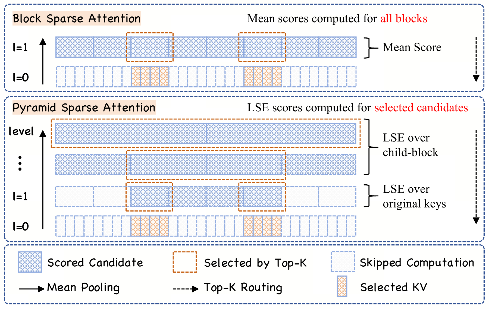
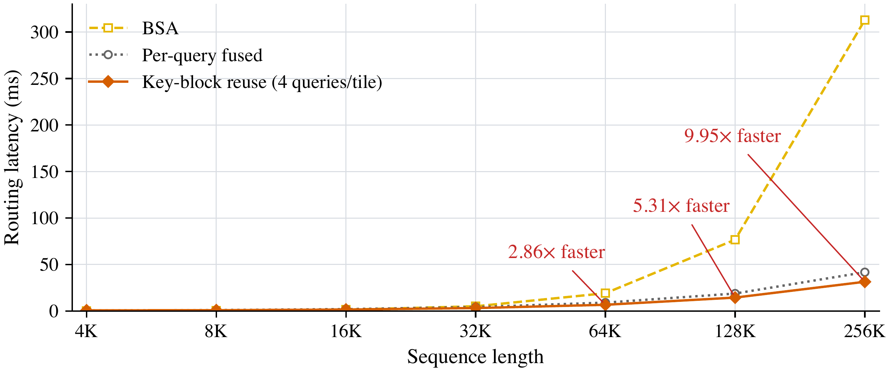

# Block Sparse Attention with Log-Linear Complexity

> This repository is a research reimplementation based on the paper and publicly available GitHub code. It is not the original codebase used for the paper's experiments.

[**Block Sparse Attention with Log-Linear Complexity**](https://arxiv.org/abs/2609.31093)

<p align="center">
  <a href="assets/figures/figure1_hierarchical_routing_lse.pdf"></a>
  <a href="assets/figures/routing_latency_scaling.pdf"></a>
</p>

PISA reduces block-selection cost through a coarse-to-fine search over a hierarchy of mean-pooled keys. Intermediate candidates are scored by LogSumExp over their child summaries; leaf candidates use LogSumExp over the original keys. Attention then operates on the original keys and values in the selected blocks. With fixed block size, branching factor and Top-K budget, selection has $O(N\log N)$ complexity.

For training and prefill, hierarchical routing is followed by grouped leaf scoring, with Q4 sharing each key-block load across up to four query positions. Decoding uses a fused selection path. See the [paper](https://arxiv.org/abs/2609.31093) for the method and experimental results.

## Features

- PISA LSE selection, first-order and second-order scoring variants.
- Fused and grouped Triton kernels, with configurable block size, Top-K and forced blocks.
- Full attention, BSA and NSA baselines, including NSA's learnable compression branch.
- A standalone `pisa-attention` package and Transformers-compatible LLaMA models.
- PT and CPT training, checkpoint conversion, lm-eval and RULER evaluation.

## Repository Layout

```text
pisa/                    Attention operators, examples and selection benchmark.
xmixers/                 Model definitions, token mixers and evaluation harness.
flame/                   Trainer, data loaders, checkpoints and model configs.
flame_script/env/        Environment setup.
flame_script/flame_task/ Training, checkpoint conversion and lm-eval scripts.
flame_script/ruler/      RULER evaluation.
launch_pt.sh             Pretraining experiments.
launch_cpt.sh            Continued-pretraining experiments.
```

## Installation

The training environment requires Linux x86_64 (glibc 2.28+), Python 3.11 and CUDA 12.8. Installation includes the dependencies in `flame/requirements.txt` and the local `pisa`, `xmixers` and `flame` packages. Key versions:

```text
torch==2.7.0+cu128
triton==3.3.0
transformers==4.56.1
flash-linear-attention==0.5.2
fla-core==0.5.2
huggingface-hub==0.36.0
datasets==3.6.0
lm-eval==0.4.9.1  (commit 0c134ee944d97998013eaff6f4e76d1b9fa87ecd)
torchtitan       (commit eddce126)
```

lm-eval includes the [task patch](#lm-eval-version-and-task-changes).

On a connected machine with Git installed, run:

```bash
bash flame_script/env/setup_env.sh
```

For details, see [flame/requirements.txt](flame/requirements.txt) and [pisa/README.md](pisa/README.md).

## Runtime environment

Both launchers activate `.env` in the repository root by default; set `PISA_ENV_DIR` for a custom environment. To run Python commands directly, activate the environment from the repository root:

```bash
# Optional: use a custom environment
# export PISA_ENV_DIR=/path/to/pisa-env
source "${PISA_ENV_DIR:-$PWD/.env}/bin/activate"
```

### Offline cache paths (optional)

Before starting Python or either launcher, point these variables to caches prepared on a connected machine. For standalone offline commands, also set the three offline flags:

```bash
export HF_HOME=/path/to/huggingface
export HF_HUB_CACHE="$HF_HOME/hub"
export HF_DATASETS_CACHE="$HF_HOME/datasets"
export HF_MODULES_CACHE="$HF_HOME/modules"
export HF_HUB_OFFLINE=1
export HF_DATASETS_OFFLINE=1
export TRANSFORMERS_OFFLINE=1
```

Use the same cache paths during data preparation and evaluation; adjust the subdirectory variables if your caches are stored elsewhere or you change `HF_HOME`. Both launchers set these offline flags automatically and default WandB to offline mode. Keep the environment, repository and cache paths accessible at the same locations on all nodes. Training data and tokenizer paths are configured below.

## Data Preparation

Prepare the following data before training. The paths below are examples; set each environment variable to your local directory.

| Data | Source and required files | Local path |
|---|---|---|
| Tokenizer | [GPT-2 tokenizer](https://huggingface.co/openai-community/gpt2/tree/main) configuration and vocabulary files (`*.json` and `merges.txt`). | `PISA_TOKENIZER_PATH=/path/to/pisa-data/tokenizers/gpt2` |
| PT training data | Parquet shards from [HuggingFaceFW/fineweb-edu](https://huggingface.co/datasets/HuggingFaceFW/fineweb-edu), using the [10BT subset](https://huggingface.co/datasets/HuggingFaceFW/fineweb-edu/tree/main/sample/10BT) for this example. | `PISA_DATA_PATH=/path/to/pisa-data/fineweb-edu/sample/10BT` |
| CPT training data (16K) | ProLong Mix v2, derived from [princeton-nlp/prolong-data-64K](https://huggingface.co/datasets/princeton-nlp/prolong-data-64K): decoded from Llama-3 token IDs, retokenized with GPT-2, deduplicated, mixed and packed into Zarr arrays with document boundaries. | `PISA_DATA_PATH=/path/to/pisa-data/prolong-gpt2-cpt-mix-v2/16k` |
| Evaluation data | Datasets for the 13 lm-eval tasks below, prepared with the installed lm-eval. | `HF_HOME=/path/to/huggingface`, including `hub/`, `datasets/` and `modules/`. |

CPT data is stored in 64K-token rows, each split into four 16K sequences for training while preserving document boundaries. `PISA_DOCUMENT_COUNT` counts storage rows. See [flame/README.md](flame/README.md#cpt-data) for the data layout.

Evaluation tasks: `wikitext`, `lambada_openai`, `boolq`, `piqa`, `hellaswag`, `winogrande`, `arc_easy`, `arc_challenge`, `openbookqa`, `social_iqa`, `swde`, `squad_completion` and `fda`.

All data and cache paths must be accessible from the training nodes.

## Training

Run from the repository root and keep only one experiment command active in the corresponding launcher. Detailed settings are in [launch_pt.sh](launch_pt.sh), [launch_cpt.sh](launch_cpt.sh), and the [PT](flame/configs/pisa/pt/) and [CPT](flame/configs/pisa/cpt/) model configs.

Configure the node count (`NNODES`), GPUs per node (`NPROC_PER_NODE`), `NODE_RANK`, `MASTER_ADDR` and `MASTER_PORT` in the job environment, or use the platform-provided `PET_*` equivalents. For multi-node training, submit one job that runs the same launcher on every node and keep `debug=false`. All nodes must share the master address and port, use distinct node ranks, and access the same environment, data and checkpoint paths. Launch details are in [train.sh](flame_script/flame_task/train.sh).

### PT

Select the experiment in [launch_pt.sh](launch_pt.sh), set the data paths and output directory, then launch:

```bash
export PISA_DATA_PATH=/path/to/pt-parquet
export PISA_TOKENIZER_PATH=/path/to/pisa-data/tokenizers/gpt2
export PISA_OUTPUT_DIR="$PWD/outputs/pisa-pt"
bash launch_pt.sh
```

### CPT

Select the experiment in [launch_cpt.sh](launch_cpt.sh) and use a matching PT checkpoint. This example runs 10B-token continued pretraining at a 16K sequence length on two nodes with eight GPUs each. Run the launcher on both nodes with the rank and master settings described above:

```bash
export PISA_DATA_PATH=/path/to/pisa-data/prolong-gpt2-cpt-mix-v2/16k
export PISA_TOKENIZER_PATH=/path/to/tokenizer
export PISA_SOURCE_CHECKPOINT=/path/to/PT/checkpoint/step-100000
export PISA_DOCUMENT_COUNT=160000
export PISA_OUTPUT_DIR="$PWD/outputs/pisa-cpt"
bash launch_cpt.sh
```

CPT starts from PT model weights and Adam moments. To resume an existing run, keep its output directory and training plan; `PISA_LOAD_STEP=-1` selects the latest complete checkpoint. See [flame/README.md](flame/README.md) for data and training details.

## Evaluation

Training defaults to `PISA_POST_TRAIN=eval`, which converts the checkpoint and runs all 13 default lm-eval tasks. Set it to `convert` to export only, or `none` to finish after training.

### lm-eval version and task changes

The [installer](flame_script/env/setup_env.sh) uses the lm-eval revision listed under [Installation](#installation) and applies [lm_eval_tasks.patch](flame_script/env/lm_eval_tasks.patch):

- FDA and SQuAD Completion: apply `.strip()` to the input `doc["text"]` and target `doc["value"]`.
- Social IQA: change the dataset path from `social_i_qa` to `allenai/social_i_qa`.

The patch leaves `process_results` unchanged: `contains` still uses the original `doc["value"]`. SWDE is unchanged. The package reports `0.4.9.1`; use the pinned source and patch when comparing results.

### Evaluate an existing checkpoint

Use [convert_and_eval.sh](flame_script/flame_task/convert_and_eval.sh) to convert and evaluate a Flame checkpoint, or [harness.py](xmixers/evals/harness.py) to evaluate an already converted Transformers checkpoint. RULER evaluation uses [ruler/script.sh](flame_script/ruler/script.sh); log and output locations are documented in [flame/README.md](flame/README.md#logs-and-evaluation).

## Block-Selection Benchmark

```bash
python pisa/benchmarks/flash_sparse_attn/top_k_pyramid/benchmark.py
```

The benchmark reports LSE fused, Q1, Q2, Q4 and BSA timings for 4K–256K tokens. Defaults are BF16, B=1, Hq=32, Hkv=2, D=64, block size 64 and Top-K=8. Each measurement includes summary construction and prefill selection, excluding attention and backward. CSV/JSON outputs are saved in `stat/block-selection`. Use `--help` for other lengths, dimensions and timing options. These are measurements of this implementation; the paper's results are reported in the paper, and timing alone does not establish numerical equivalence.

## Citation

```bibtex
@article{tang2026pisa,
  title={Block Sparse Attention with Log-Linear Complexity},
  author={Bohao Tang and Zhen Qin and Yuqi Pan and Zheng Li and Pengfei Liu},
  journal={arXiv preprint arXiv:2609.31093},
  year={2026}
}
```

## License

See [LICENSE](LICENSE) and [NOTICE](NOTICE). Reused components retain their respective licenses and attribution in `pisa/`, `xmixers/` and `flame/`.
